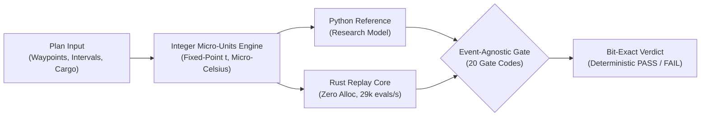

# SW-README - switchyard-logistics

[](https://github.com/NatthaphongY/switchyard-logistics/actions/workflows/ci.yml)
[](LICENSE-SPEC)
[](LICENSE)
[](pyproject.toml)
[](engine/Cargo.toml)
[](https://peps.python.org/pep-0561/)

| Document ID: SW-README | Kind | Repository document | Version: 3.2 | Status: Active | Spec: SW-06 |

> **An event-agnostic compliance gate and verifiable reference implementation for time-and-temperature critical logistics planning.**

Switchyard couples an integer micro-unit evaluation pipeline in Python with a zero-dependency Rust replay core, proving compliance against pre-registered physical and institutional constraints.

> **AI Agents**: See [llms.txt](llms.txt) and [AGENTS.md](AGENTS.md).

---

## Architecture Pipeline

Switchyard evaluates cold-chain logistics plans across physical state bounds and institutional constraints via a dual-engine architecture:



## Performance & Parity Summary

| Metric | Python Reference | Rust Core Engine | Conformance Status |
|---|---|---|---|
| Evaluation Throughput | ~320 evals/s | 29,653 evals/s | 92x Speedup |
| Numeric Precision | Integer micro-units | Integer micro-units | Bit-Exact (0 drift) |
| Scenario Coverage | 300 / 300 scenarios | 300 / 300 scenarios | 100% Identical |
| Ambient Data Source | ERA5 (July 1991-2020) | Frozen LUT (Integer) | Exact Replay |
| Gate Codes Evaluated | 20 Formal Codes | 20 Formal Codes | Full Compliance |
| Memory Overhead | Standard runtime | Zero alloc during eval | Leak-free |

## Key Highlights

- High-Throughput Verification: 29,653 evaluations per second in Rust replay core.
- Bit-Exact Conformance: 300 of 300 test scenarios match identically between Python and Rust.
- Integer Fixed-Point Arithmetic: All evaluation logic operates strictly on micro-units and integer minutes.
- Event-Agnostic Gate: Decisions evaluate state and constraints directly; no named event strings drive branches.
- Pre-Registered Benchmark: Gate B4 measurement separates optimized plans from standard practice across all 6 criteria.
- Open Climatology: Ambient physical layer derived from frozen July 1991-2020 ERA5 reanalysis data.

## 30-Second Quickstart

Clone the repository and install the development package locally:

```bash
git clone https://github.com/NatthaphongY/switchyard-logistics.git
cd switchyard-logistics
pip install -e .
```

Run the complete Python test suite:

```bash
py -3.13 -m pytest -q
```

Build and test the native Rust engine:

```bash
cd engine
cargo test
cargo build --release
cd ..
```

## Reproduction of Published Evidence

Every quantitative claim in this repository is reproducible from source using pre-recorded seeds:

```powershell
py -3.13 -X utf8 scripts/export_instances.py --scenarios 300
py -3.13 -X utf8 scripts/run_b4.py --scenarios 300
py -3.13 -X utf8 scripts/stress_parity.py --repeats 200
```

## Verification Checklist

| Target | Command | Criterion |
|---|---|---|
| Full Test Suite | `py -3.13 -m pytest -q` | 114 passed |
| Ambient Datasets | `py -3.13 -m pytest tests/test_weather_regions_s.py -q` | ERA5 integers, provenance valid |
| Public Sanitization | `py -3.13 -m pytest tests/test_research_scrub_s.py -q` | Zero internal paths or private tokens |
| Structural Cleanliness | `py -3.13 -m corral.cli check .` | 0 findings (0 blocking) |
| Rust Core Parity | `switchyard-core --instances evidence/instances.txt --threads 8 --repeat 200` | 0 mismatches across 300 scenarios |
| Liveness & Robustness | `py -3.13 -X utf8 scripts/stress_parity.py --repeats 200` | PASS under hostile inputs |

## Document Set

| ID | Document | Description |
|---|---|---|
| SW-02 | `docs/02_TRACK_B_COLDCHAIN.md` | Problem statement, capability gap, and system architecture |
| SW-03 | `docs/03_EVIDENCE_2026.md` | Evidence register with technical and market source citations |
| SW-05 | `docs/05_REPRODUCTION.md` | Reproduction guide: commands for regenerating every published figure |
| SW-06 | `docs/06_EVENT_AGNOSTIC_GATE.md` | Specification of the 20-code compliance gate (normative) |
| SW-07 | `docs/07_LICENSING.md` | Dual licensing model, thresholds, and clean-room provenance |
| SW-08 | `docs/08_B4_MEASUREMENT.md` | Pre-registered Gate B4 measurement and empirical separation results |
| SW-09 | `docs/09_CATALYST_LAYER.md` | Propagation, information, and institutional cascade layers |
| SW-10 | `docs/10_NUMERIC_CORE.md` | Fixed-point numeric engine, Rust core, and throughput benchmarks |
| SW-11 | `docs/11_PHYSICS_LAYERS.md` | Queueing, traffic, thermal, reliability, and epidemic models |
| SW-12 | `docs/12_ROBUSTNESS.md` | Parity proofs, hostile input bounds, liveness, and memory stability |
| SW-PKG | `PACKAGE.md` | Scope manifest: published artifacts versus withheld private assets |

*Note: The normative document is SW-06. If any document conflicts with it, SW-06 governs.*

## Contributing & Security

- Contributions are welcome under our development workflows and verification gates. Please refer to [CONTRIBUTING.md](CONTRIBUTING.md) for testing guidelines and code standards.
- To report potential vulnerabilities or security flaws, please consult [SECURITY.md](SECURITY.md) for our disclosure policy and reporting process.
- All notable changes and release milestones are tracked in [CHANGELOG.md](CHANGELOG.md).

## Architecture & Dual-Licensing

- Specification (`docs/06_EVENT_AGNOSTIC_GATE.md` and document set) is licensed under **Apache-2.0** (`LICENSE-SPEC`) to permit independent, citation-backed implementations.
- Reference implementation (`src/`, `engine/`, and tooling) is licensed under the **Business Source License 1.1** (`LICENSE`), with defined Use Grants converting to open source on the Change Date.
- No trademarks, product names, or marks are licensed.
